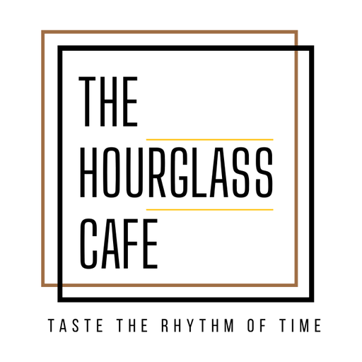
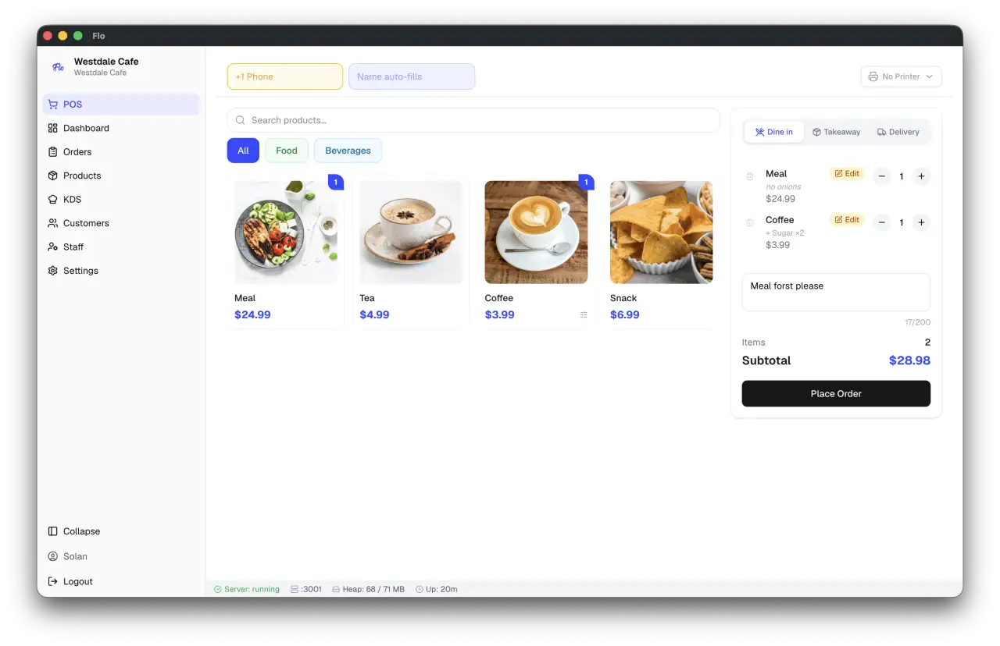

<div align="center">
  
  <h1>Hourglass Cafe</h1>
  <p><strong>Enterprise Point of Sale (POS), Kitchen Display System (KDS) & Online Customer Ordering Portal</strong></p>
  <p><em>Taste The Rhythm of Time</em></p>

  <p>
    <a href="https://github.com/kunalworks01/POS-Cafe-repo"></a>
    
    
    
    
    
    
    
  </p>
</div>

---

<p align="center">
  
</p>

## Overview

**Hourglass Cafe POS** is an enterprise-grade, offline-first Point of Sale (POS) and operations ecosystem built specifically for modern cafés, restaurants, and cloud kitchens.

Engineered with local-first reliability at its core, Hourglass Cafe ensures 100% operational uptime by storing transactions, orders, and customer data in an ACID-compliant local SQLite database. Mission-critical counter billing and kitchen dispatching continue uninterrupted even during internet outages, while automated background synchronizers upload database snapshots to AWS S3 cloud infrastructure.

---

## Key Highlights

- 🛒 **Offline-First POS Counter Terminal:** Instant touch billing, table management, held tickets, split payments (Cash, Card, UPI, Loyalty points), tax calculation, and discounts.
- 🌐 **Customer Online Ordering Portal:** Mobile-first web menu allowing customers to browse items, customize add-ons, and place pre-orders with live order status tracking (`:3003/order`).
- 🍳 **Standalone Kitchen Display System (KDS):** Multi-station kitchen screen with FIFO order staging, live WebSocket updates, and audio alerts on incoming tickets (`:3002`).
- ⏳ **Unsettled & Pending Orders Drawer:** Instant drawer access in the POS topbar to inspect open tabs, distinguish unsettled dine-in tickets from online pre-orders, and complete one-click bill settlement.
- 🖨️ **Thermal Receipt & KOT Printing:** Direct ESC/POS printing over TCP, USB, and WebUSB with 58 mm and 80 mm paper formats, custom logos, and kitchen order tickets.
- ☁️ **AWS S3 Cloud Database Backup:** Scheduled and automated database snapshots compressed (`.db.gz`) and synchronized to Amazon S3 (`hourglass-pos-database-backup-866874944450`) with 30-day retention policies.
- 📊 **Business Intelligence & Audit Logs:** Role-based access control (Owner, Manager, Cashier, Server, Chef), granular shift closures, cash drawer balancing, and sales analytics.
- 🌍 **Internationalization & Multi-Currency:** Out-of-the-box support for 24+ languages (including RTL for Arabic, Urdu, and Farsi) and 131 country profiles.

---

## System Architecture

```text
                               ┌────────────────────────────────────────────────────────┐
                               │                    Hardware Devices                    │
                               │  Thermal Printers (ESC/POS) · Cash Drawers · Scanners  │
                               └──────────────────────────▲─────────────────────────────┘
                                                          │ Raw ESC/POS
┌────────────────────────────┐ ┌──────────────────────────┴─┐ ┌────────────────────────────┐
│      POS Desktop UI        │ │  Kitchen Display System    │ │   Customer Online Portal   │
│ Next.js 14 / React 18      │ │ Standalone Web App         │ │ Mobile-First Web Menu      │
│ Port: 3001                 │ │ Port: 3002                 │ │ Port: 3003                 │
└─────────────▲──────────────┘ └──────────────▲─────────────┘ └──────────────▲─────────────┘
              │                               │                              │
              │ HTTP / WebSockets             │ WebSockets                   │ HTTP / WebSockets
              ▼                               ▼                              ▼
┌──────────────────────────────────────────────────────────────────────────────────────────┐
│                             Electron 44 / Node.js Main Process                           │
│     - Express REST API Engine                      - Real-Time WebSocket Hub             │
│     - SQLite Database (better-sqlite3)             - Receipt & KOT Print Pipeline        │
│     - Staff Authorization & PIN Security           - FIFO Order Lifecycle Manager        │
└────────────────────────────────────────────┬─────────────────────────────────────────────┘
                                             │
                                             ▼
                      ┌──────────────────────────────────────────────┐
                      │             AWS Cloud Infrastructure         │
                      │  - AWS S3 Compressed Database Snapshots      │
                      │  - Automated 30-day Retention Backups        │
                      │  - Cloud DB Sync Engine                      │
                      └──────────────────────────────────────────────┘
```

---

## Service Port Reference

| Port | Service | Description | Access URL |
| :--- | :--- | :--- | :--- |
| **3001** | **POS Desktop / REST API** | Main Counter Billing & Management System | `http://localhost:3001/pos` |
| **3002** | **Kitchen Display System** | Real-time kitchen ticket management & KOT routing | `http://localhost:3002/kds` |
| **3003** | **Customer Order Portal** | Mobile-optimized online ordering & waiter companion | `http://localhost:3003/order` |

---

## Quick Start & Installation

### Prerequisites

- **Node.js:** `>= 22.12.0`
- **npm:** `>= 10.0.0`
- **Operating System:** Linux (Ubuntu/Debian, Fedora, Arch), macOS 12+, or Windows 10+ (64-bit)

### 1. Clone Repository

```bash
git clone git@github.com:kunalworks01/POS-Cafe-repo.git
cd POS-Cafe-repo
```

### 2. Install Dependencies

```bash
npm install
```

### 3. Configure Environment

Copy the example environment configuration:

```bash
cp .env.example .env
```

Review or modify `.env`:

```env
NODE_ENV=production
PORT=3001
KDS_PORT=3002
SERVER_APP_PORT=3003
JWT_SECRET=your-secure-random-jwt-secret
AWS_S3_BACKUP_BUCKET=hourglass-pos-database-backup-866874944450
AWS_REGION=ap-south-1
```

### 4. Launch Application

To launch both the backend services and the Electron desktop application:

```bash
npm run dev
```

Or using the production launcher script:

```bash
bash start.sh
```

---

## Building & Packaging

Hourglass Cafe supports native desktop packaging across all major platforms:

```bash
# Package for current operating system
npm run build:frontend && npm run build && npm run pack

# Linux (.AppImage, .deb, Snap)
npm run release:linux

# macOS (.dmg, Universal)
npm run release:mac

# Windows (.exe installer, AppX)
npm run release:win
```

---

## Cloud Backup & Disaster Recovery

Hourglass Cafe features an automated backup system:

1. **Local Snapshots:** Timestamped SQLite database archives stored locally under `backups/flo_backup_*.db.gz`.
2. **AWS S3 Cloud Archival:** Every backup is automatically transmitted to Amazon S3:
   ```bash
   bash scripts/backup_db.sh
   ```
3. **Automated Pruning:** Retains 30 days of rolling backups, automatically purging older archives to conserve disk space.

---

## Supported Languages & Regions

Hourglass Cafe includes UI translations and regional profiles for:

- **Languages:** English, Spanish, French, Portuguese, Russian, Filipino, Turkish, Persian (Farsi), Arabic, Urdu, German, Italian, Japanese, Simplified Chinese, Traditional Chinese, Korean, Indonesian, Dutch, Hindi, Bengali, Albanian, Vietnamese, Thai, and Nepali.
- **RTL Support:** Native right-to-left layout and typography for Arabic, Hebrew, Persian, and Urdu.
- **131 Country Profiles:** Preconfigured currency symbols, tax formats, and timezones.

---

## Contributing

Contributions, feedback, and pull requests are warmly welcomed:

1. Fork the repository
2. Create your feature branch (`git checkout -b feature/amazing-feature`)
3. Commit your changes (`git commit -m 'feat: add amazing feature'`)
4. Push to the branch (`git push origin feature/amazing-feature`)
5. Open a Pull Request

---

## License

This project is open-source software licensed under the [MIT License](LICENSE).

---

<div align="center">
  <p><strong>Hourglass Cafe</strong> — Taste The Rhythm of Time</p>
  <p>Maintained by <a href="https://github.com/kunalworks01">Kunal Vashisth</a></p>
</div>
